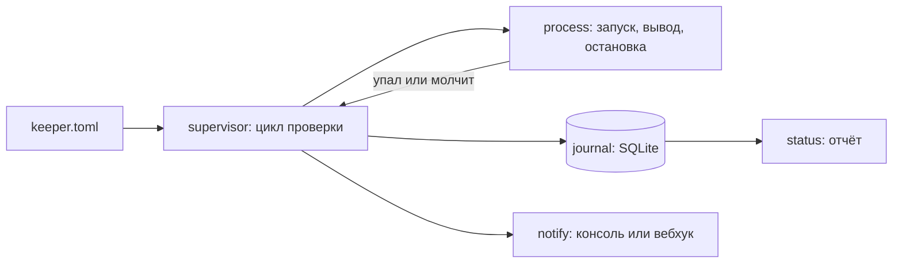

# agent-keeper — присмотр за фоновыми агентами

Фоновые работники — сборщики отчётов, разборщики почты, боты — падают и зависают. Присмотр запускает их, следит за выводом, поднимает упавших с растущей паузой, а если агент не поднимается совсем — перестаёт его дёргать и говорит об этом человеку. Все события пишутся в журнал, чтобы утром можно было ответить на вопрос «почему ночью ничего не собралось».

```text
$ keeper demo --seconds 10

! «падающий» не поднимается: 3 неудач подряд. Присмотр остановлен.
! «зависающий» молчит 2 с — перезапускаю.

Агент       Состояние        Перезапусков  Неудач подряд  Последняя причина
надёжный    остановлен       0             0              —
падающий    цепь разомкнута  2             3              завершился с кодом 1
зависающий  остановлен       3             3              молчит 2 с

События с 12.09 03:15:
  зависающий: зависание — 3
  зависающий: перезапуск — 3
  надёжный: запуск — 1
  падающий: падение — 3
  падающий: цепь разомкнута — 1
  присмотр: уведомление — 4

Последние события:
  12.09 04:15:19  падающий: падение — завершился с кодом 1. Последнее: начал работу; не смог подключиться к очереди
  12.09 04:15:19  падающий: цепь разомкнута — неудач подряд: 3
  12.09 04:15:19  зависающий: зависание — молчит 2 с. Последнее: начал работу
  12.09 04:15:20  зависающий: перезапуск — python зависающий.py
```

Демо поднимает трёх игрушечных агентов — надёжного, падающего и зависающего — со сжатым временем: проверка раз в полсекунды, зависанием считается молчание две секунды. За десять секунд видно всё поведение присмотра.

## Что делает

| Возможность | Подробности |
|---|---|
| Запуск и остановка | обычные процессы, вывод читается в фоне; при остановке — мягкое завершение, через пять секунд принудительное |
| Падение | процесс завершился — запись в журнал с кодом возврата и последними строками вывода |
| Зависание | агент молчит дольше `idle_timeout` — считается зависшим, перезапускается, о чём уходит уведомление |
| Растущая пауза | 2, 4, 8, 16 секунд… но не больше пяти минут |
| Размыкание цепи | больше `restart_limit` неудач подряд — агент больше не поднимается, приходит уведомление |
| Восстановление | агент, проживший минуту без происшествий, обнуляет счётчик неудач |
| Журнал | SQLite: запуск, падение, зависание, перезапуск, размыкание, остановка, уведомления |
| Уведомления | в консоль или в вебхук; недоставленное уведомление не останавливает присмотр |

## Как запустить

```bash
uv sync
uv run keeper demo                                 # три игрушечных агента, без настройки
uv run keeper run --config examples/keeper.toml    # присмотр до Ctrl+C
uv run keeper once --config examples/keeper.toml   # один проход — для планировщика
uv run keeper status --config examples/keeper.toml --hours 24
```

Настройки — один TOML-файл:

```toml
[keeper]
journal = "журнал.sqlite"
check_every = 5
# webhook = "https://chat.example/hooks/keeper"

[[agent]]
name = "сборщик-отчётов"
command = "python -m worker --queue reports"
restart_limit = 5      # столько неудач подряд — и присмотр перестаёт поднимать агента
backoff = 2            # первая пауза перед перезапуском, дальше 4, 8, 16 секунд
idle_timeout = 300     # молчит дольше пяти минут — считаем зависшим

[[agent]]
name = "ночной-отчёт"
command = "python -m worker --once --report nightly"
restart_limit = 0      # упал — разбираемся руками, не поднимаем
```

## Как устроено



| Модуль | Ответственность |
|---|---|
| `config.py` | разбор TOML с понятными ошибками, растущая пауза, значения по умолчанию |
| `process.py` | запуск процесса, чтение вывода в отдельном потоке, признаки жизни, остановка |
| `supervisor.py` | цикл: проверка, перезапуск, размыкание цепи, восстановление |
| `journal.py` | события в SQLite и выборки по ним |
| `notify.py` | консоль и вебхук; сбой доставки не роняет присмотр |
| `status.py` | таблица состояния и сводка по журналу |
| `demo.py` | три игрушечных агента со сжатым временем |

## Как проверялось

- `ruff format`, `ruff check` (E, F, W, I, B, UP, S — bandit, C4, SIM, PT, RUF, DTZ, ASYNC) и `mypy --strict` — без замечаний.
- `pytest` — 29 тестов за 7,4 с, из них половина поднимает настоящие процессы:
  - настройки: команда строкой и списком, значения по умолчанию, растущая пауза и её потолок, десять видов ошибок в файле;
  - процессы: живой агент подаёт признаки жизни, упавший распознаётся по коду возврата, молчащий — по времени без вывода, остановка убивает долгий процесс, неизвестная команда объясняется;
  - присмотр: падающий агент перезапускается и в итоге размыкает цепь, зависший перезапускается с уведомлением, надёжный не трогается и обнуляет счётчик неудач, сбой вебхука не останавливает присмотр;
  - командная строка: один проход, отчёт по журналу, демо, испорченный файл настроек.
- Демо (`keeper demo --seconds 10`) выдаёт то, что показано выше: три перезапуска зависающего, размыкание цепи у падающего, четыре уведомления.
- Сквозной прогон всего портфолио 13.09.2026 нашёл здесь настоящий дефект, которого не увидели ни линтер, ни типы, ни сами тесты при обычном запуске. Вывод дочернего процесса читался жёстко как UTF-8, а Python на русской Windows пишет в пайп в кодировке системы — cp1251. Русские строки агента превращались в символы замены, и проверка «агент рапортует „живу“» падала. Раньше это не всплывало только потому, что в окружении оказывалась переменная `PYTHONUTF8`, которая чинила симптом у дочернего процесса. Теперь вывод читается байтами и декодируется перебором кодировок: строгий UTF-8, затем кодовая страница системы, затем cp866 и cp1251. Проверено тремя прогонами без переменных UTF-8 — 29 тестов проходят.

### Не проверялось

- Долгая работа: сутки под присмотром, тысячи перезапусков, ротация журнала — не проверялись.
- Агенты запускались только как процессы Python на Windows. Службы, контейнеры и systemd не поддерживаются.
- Уведомления проверены на эмуляторе вебхука; в настоящий чат (Telegram, Mattermost) ничего не отправлялось.
- Присмотр не следит за памятью и загрузкой процессора: признак жизни — только вывод процесса.
- Один присмотр — один хост: распределённой работы и передачи агентов между машинами нет.

## Структура

```text
src/keeper/   config, process, supervisor, journal, notify, status, demo, cli
tests/        config, journal, process (настоящие процессы), supervisor, cli
examples/     keeper.toml — пример настроек
```
